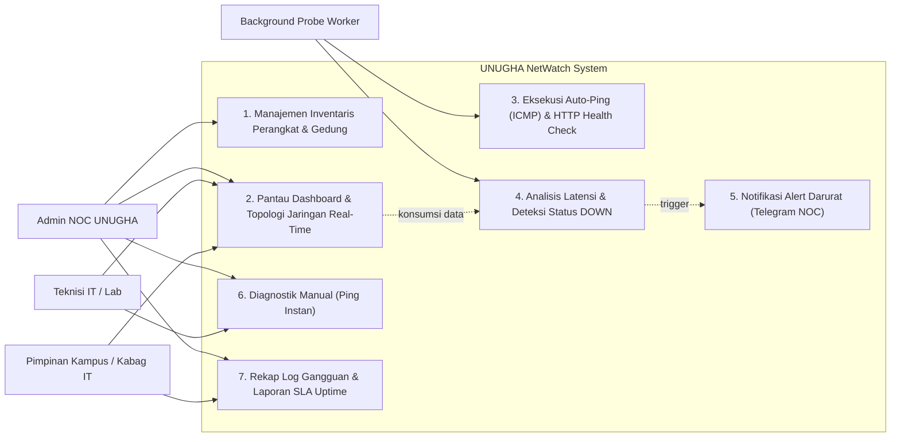
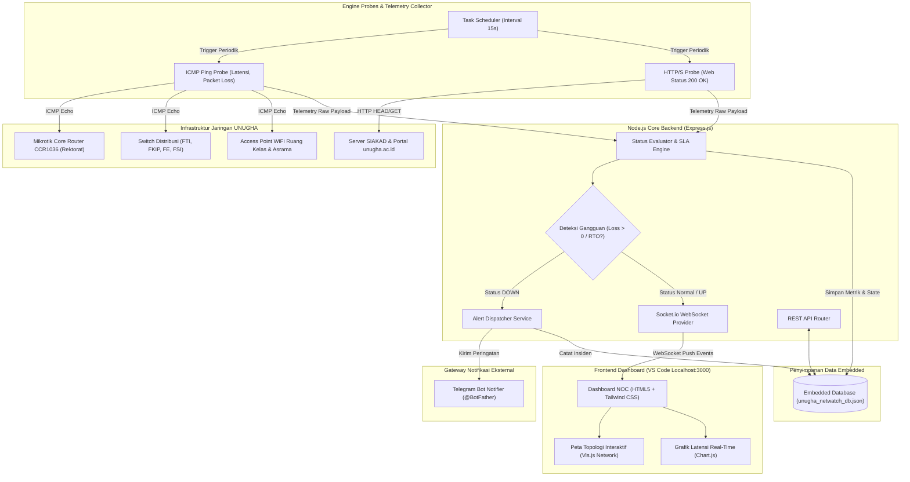
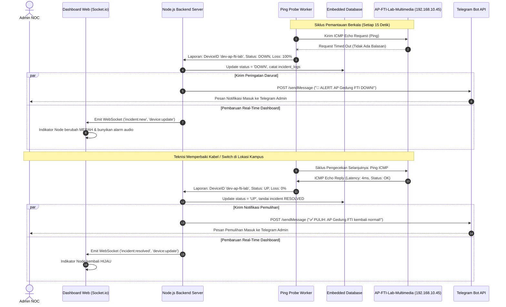
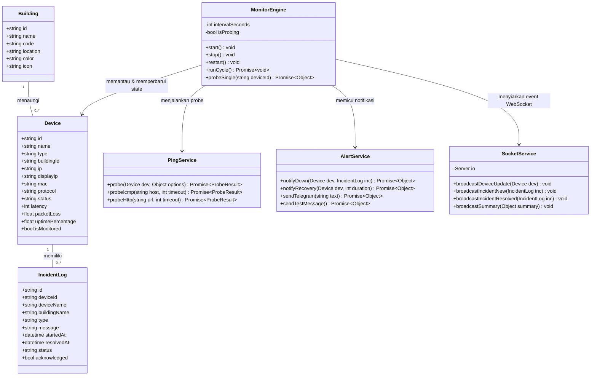
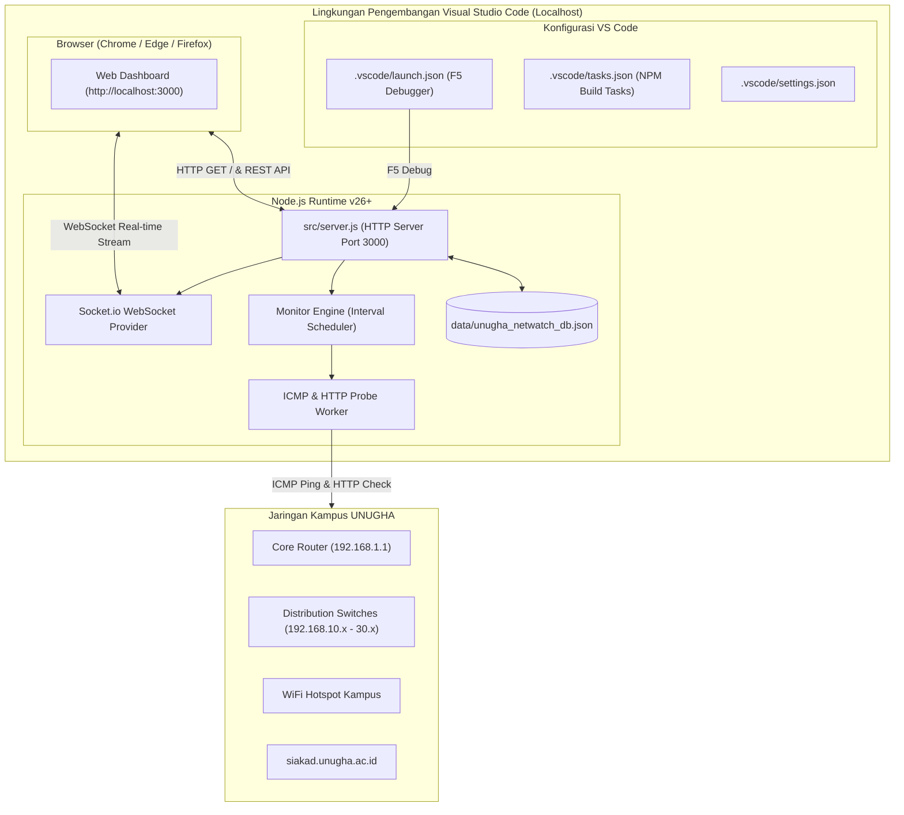

# 🌐 UNUGHA NetWatch
**Sistem Monitoring Jaringan Kampus Universitas Nahdlatul Ulama Al Ghazali (UNUGHA) Cilacap**

Aplikasi monitoring jaringan real-time berbasis **Node.js, Express, dan Socket.io** yang dirancang untuk memantau performa, latensi, uptime SLA, dan ketersediaan perangkat jaringan (*Core Router Mikrotik, Switch Distribusi Gedung, Access Point WiFi, dan Server Kampus SIAKAD/Web*).

Aplikasi ini dapat langsung dijalankan dan di-debug di **Visual Studio Code (VS Code)** hanya dengan tombol **F5** atau perintah `npm run dev`.

---

## 📑 Daftar Diagram Sistem

### 1. Diagram Use Case
Diagram ini menggambarkan interaksi para pengguna (*Admin NOC, Teknisi IT Lab, Pimpinan Kampus*) dan *Background Probe Worker* dengan fitur-fitur aplikasi.



---

### 2. Diagram Antigravity (Arsitektur Pipeline Sistem)
Diagram ini menjelaskan alur data holistik dari infrastruktur fisik jaringan kampus menuju telemetry collector, Node.js core engine, penyimpanan database embedded, hingga ke dashboard web visual dan gateway Telegram Bot.



---

### 3. Diagram Sequence
Alur siklus pengecekan otomatis saat perangkat jaringan (misalnya Access Point Gedung FTI) mengalami putus koneksi (*DOWN/RTO*) hingga pemulihan kembali (*UP/Resolved*):



---

### 4. Diagram UML

#### 4.1 Class Diagram (Struktur Entitas & Layanan Backend)


#### 4.2 Component & Deployment Diagram di VS Code


---

## 🚀 Panduan Menjalankan di Visual Studio Code (VS Code)

### 1. Buka Proyek di VS Code
1. Jalankan aplikasi **Visual Studio Code**.
2. Klik menu **File > Open Folder...** (atau tekan `Ctrl + K, Ctrl + O`).
3. Pilih folder:
   ```text
   c:\Users\asnga\Downloads\e-tahfidz\unugha-netwatch
   ```

### 2. Instalasi Dependensi (Jika Diperlukan)
Buka Terminal terintegrasi di VS Code (`Ctrl + \`` atau menu `Terminal > New Terminal`), lalu jalankan:
```bash
npm install
```

### 3. Menjalankan Aplikasi
Ada 2 cara yang sangat mudah:

#### Cara 1: Menggunakan Tombol F5 (One-Click Debugging)
- Cukup tekan tombol **F5** pada keyboard Anda.
- VS Code akan otomatis memilih konfigurasi `"▶️ Jalankan UNUGHA NetWatch (Nodemon Dev)"` dan memulai server dengan fitur hot-reload.

#### Cara 2: Melalui Terminal VS Code
Jalankan perintah berikut pada terminal:
```bash
npm run dev
```
*(Atau `npm start` untuk mode produksi).*

### 4. Akses Dashboard
Buka browser favorit Anda (Google Chrome / Microsoft Edge) dan ketik alamat:
```text
http://localhost:3000
```

---

## 🛠️ Fitur Utama Aplikasi

1. **Dashboard Real-Time**:
   - Kartu metrik: Total Perangkat, Online (UP), Peringatan (WARNING), Gangguan (DOWN), Rata-rata Latensi, dan Persentase Uptime SLA Kampus.
   - Live Pulse status WebSocket yang menunjukkan kondisi koneksi backend secara langsung.
2. **Monitoring Bandwidth & Traffic Uplink ISP (500 Mbps)**:
   - Telemetri throughput real-time interface Gateway Mikrotik (ether1-WAN Telkom Astinet).
   - Grafik dua jalur (Dual-Line Chart) untuk *Download (In)* dan *Upload (Out)* dalam satuan Mbps beserta bar persentase utilisasi link.
3. **Peta Topologi Interaktif & Denah Spasial Kampus**:
   - Ditenagai oleh *Vis.js Network*, memvisualisasikan hirarki hubungan dari Core Mikrotik Rektorat ke Switch Distribusi Gedung FTI, FSI, FKIP/FE, Perpustakaan, hingga ke Access Point dan Server Kampus.
   - Pilihan tampilan **Denah Spasial** tata letak fisik gedung kampus UNUGHA di Kesugihan, Cilacap.
   - Tombol satu-klik **"📸 Unduh PNG"** untuk mengekspor diagram topologi definisi tinggi untuk laporan akreditasi (LAM-INFOKOM/BAN-PT) atau skripsi mahasiswa.
4. **Konsol Diagnostik Interaktif (Web Terminal)**:
   - Terminal terintegrasi di browser (`unugha-noc@gateway:~$`) untuk menjalankan uji coba ping multi-paket kustom dan penelusuran rute *hop-by-hop* (*traceroute*).
5. **Simulasi Demo Failover (Kabel Putus)**:
   - Tombol **"⚡ Demo Failover"** di navbar untuk mendemonstrasikan secara langsung bagaimana sistem bereaksi saat terjadi gangguan kabel putus pada switch gedung, memicu alarm merah visual, notifikasi Telegram, dan kalkulasi SLA.
6. **Telemetri Perangkat Keras (Hardware Telemetry)**:
   - Pemantauan real-time CPU Load (%), RAM Usage (GB), dan Suhu Board (°C) untuk Router Core MikroTik CCR1036 serta VM Server SIAKAD.
7. **Grafik Latensi Real-Time**:
   - Menampilkan fluktuasi latensi rata-rata jaringan kampus secara langsung (*live streaming*) menggunakan Chart.js.
5. **Inventaris Perangkat Jaringan**:
   - Menampilkan daftar lengkap perangkat per gedung kampus.
   - Dilengkapi tombol **"Ping Langsung"** untuk pengujian diagnostik instan tanpa perlu membuka command prompt.
   - Fitur filter berdasarkan nama, alamat IP, gedung, atau status koneksi.
   - Modal form untuk menambah perangkat baru.
6. **Log Gangguan & Sistem Alert Telegram**:
   - Mencatat waktu mulai gangguan, durasi insiden, dan waktu pemulihan.
   - Mendukung integrasi bot Telegram dengan format pesan rapi berstandar NOC.
   - Audio peringatan interaktif sintetis via Web Audio API.
7. **Sistem Multi-User & Hak Akses (RBAC)**:
   - **ADMIN_NOC** (`admin` / `adminunugha`): Akses penuh kelola perangkat, pengaturan notifikasi, & kontrol.
   - **TEKNISI** (`teknisi` / `teknisiunugha`): Hak akses operator, diagnostik ping instan, dan *acknowledge* insiden gangguan.
   - **PIMPINAN** (`rektorat` / `rektoratunugha`): Hak akses eksekutif *read-only* dengan akses khusus laporan SLA.
8. **Laporan Resmi SLA & Ekspor Cetak / PDF / CSV**:
   - Dokumen laporan resmi berformat **Kop Surat Universitas Nahdlatul Ulama Al Ghazali Cilacap**.
   - Dilengkapi tabel SLA per gedung, MTTR (Mean Time to Resolution), dan kolom tanda tangan pimpinan.
   - Tombol satu klik **"Cetak / Simpan PDF"** (menggunakan dialog cetak browser dengan layout `@media print` rapi).
   - Tombol **"Download CSV"** untuk arsip dan pengolahan data di Microsoft Excel.

---

## 📁 Struktur Direktori

```text
unugha-netwatch/
├── .vscode/
│   ├── launch.json              # Konfigurasi F5 Debugging di VS Code
│   ├── tasks.json               # Tugas otomatis npm dev/start
│   └── settings.json            # Rekomendasi formatting VS Code
├── data/
│   └── unugha_netwatch_db.json  # Database embedded (otomatis tersimpan)
├── public/
│   ├── css/
│   │   └── style.css            # Styling modern tema NOC UNUGHA
│   ├── js/
│   │   └── app.js               # Logika Socket.io, Chart.js, & Vis.js
│   └── index.html               # Halaman utama Single Page Application
├── src/
│   ├── config/
│   │   └── config.js            # Pengaturan port, interval, & metadata kampus
│   ├── controllers/
│   │   ├── deviceController.js  # CRUD & manual ping handler
│   │   ├── incidentController.js# Pengelolaan insiden & acknowledge
│   │   └── statController.js    # Agregat statistik, topologi, & setting
│   ├── database/
│   │   ├── db.js                # Engine data persistence JSON
│   │   └── seeds.js             # Data master gedung & perangkat awal UNUGHA
│   ├── routes/
│   │   └── api.js               # Definisi endpoint REST API
│   ├── services/
│   │   ├── alertService.js      # Notifikasi Telegram Bot
│   │   ├── monitorEngine.js     # Background auto-probe scheduler
│   │   ├── pingService.js       # Driver probe ICMP & HTTP
│   │   └── socketService.js     # Penyedia WebSocket Socket.io
│   └── server.js                # Entry point aplikasi Express
├── .env.example                 # Contoh file konfigurasi environment
├── .env                         # Konfigurasi variabel lingkungan aktif
├── package.json                 # Metadata proyek & dependensi
└── README.md                    # Dokumentasi lengkap & diagram
```

---

*Dikembangkan untuk Pusat Komputer & Jaringan (Puskom) Universitas Nahdlatul Ulama Al Ghazali (UNUGHA) Cilacap.*
